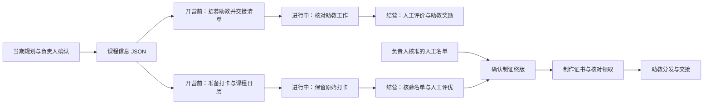

# Datawhale 组队学习运营 Skill 包

帮助组队学习负责人和助教完成每期运营：整理课程信息，招募与评价助教，准备打卡与课程日历，核验结营，制作证书并交接领取。负责人提供当期材料和人工决定，Agent 按对应 Skill 处理数据、生成预览并执行已授权操作。

本包由 Markdown 操作说明、业务规则、样例和运行脚本组成。能读取本地文件并调用所需工具的 Agent 可以按同一套文档接手；不同设备需另行准备运行环境、业务材料和平台授权。

[选择工作模块](#选择工作模块) · [查看整体流程](#整体流程) · [第一次使用](#第一次使用) · [运行环境](#运行环境) · [文档导航](#文档导航)

## 选择工作模块

课程信息是共同起点，整理步骤放在“助教招募”中；其余工作按当前任务选择入口。

| 我要做什么        | 提供什么                        | 得到什么                           | 操作入口                                                       |
| ------------ | --------------------------- | ------------------------------ | ---------------------------------------------------------- |
| 整理当期课程       | 课程规划、关联排期及负责人确认             | 统一的 `课程信息.json`、来源和待补项         | [课程信息与助教招募](skills/team-learning-recruitment/SKILL.md)     |
| 招募助教         | 课程 JSON、本期平台项目和报名材料         | 岗位草稿、招募进度、助教清单、定稿名单回写课程规划的结果   | [助教招募](skills/team-learning-recruitment/SKILL.md)          |
| 评价助教         | 当前助教清单、工作依据和人工评价的等次         | 评价预览、任务与证书办理结果、鲸币核对及待办         | [助教评价](skills/team-learning-assistant-evaluation/SKILL.md) |
| 准备打卡、日历和结营名单 | 课程 JSON、当期打卡 Base、完整提交及人工确认 | 表单与视图方案、Task 日历、结营名单、人工优秀标记和异常 | [打卡与结营](skills/team-learning-checkin/SKILL.md)             |
| 制作证书并交接领取    | 核准终版、制证参数、PPTX 模板及正式编号账本    | 证书图片、制作记录、附件与领取核对、助教清单状态回写结果   | [制证与领取](skills/team-learning-certificates/SKILL.md)        |

## 整体流程

课程信息同时供助教运营和学习者运营使用，两条工作线按各自进度衔接。



| 阶段 | 谁来做 | 输入 | 操作与输出 | 具体规则 |
| --- | --- | --- | --- | --- |
| 开营前 | 负责人、Agent | 当期规划和确认 | 整理课程 JSON，列出缺口 | [课程信息规则](skills/team-learning-recruitment/Rules.md#课程信息json-字段表) |
| 开营前 | 负责人、Agent | 课程 JSON、平台项目 | 准备岗位，核对招募进度，导出并交接助教清单，回写规划 | [招募规则](skills/team-learning-recruitment/Rules.md) |
| 开营前 | Agent、助教 | 课程 JSON、当前 Base | 准备打卡入口、Task 日历和核对视图 | [打卡与日历规则](skills/team-learning-checkin/Rules.md) |
| 进行中 | 学习者、助教、观察员 | 原始提交及实际工作依据 | 保留打卡，查看统计，记录实际问题 | [打卡规则](skills/team-learning-checkin/Rules.md)、[评价规则](skills/team-learning-assistant-evaluation/Rules.md) |
| 结营 | Agent、助教、负责人 | 完整打卡、当期条件及人工名单 | 核验资格，记录人工评优，交接核准终版 | [结营规则](skills/team-learning-checkin/Rules.md)、[终版规则](skills/team-learning-certificates/Rules.md) |
| 结营 | Agent、负责人、助教 | 核准终版、模板和正式账本 | 制证，核对附件与领取，回写制作完成状态并交接分发 | [制证与领取规则](skills/team-learning-certificates/Rules.md) |
| 结营 | 观察员、负责人、Agent | 助教工作依据和人工评价 | 核对任务、助教证书及鲸币结果 | [助教评价规则](skills/team-learning-assistant-evaluation/Rules.md) |

## 第一次使用

### 1. 保留完整包，打开本页

接收并解压完整的 `team-learning-skills/` 发布包，从本页开始。在支持文件访问的 Agent 中提供本页路径；也可使用任意 Markdown 阅读器查看文档，无需安装 Obsidian。

本地维护时，可以用 Obsidian 打开包的上一级目录，通过本地欢迎页导航；阅读和编辑的仍是包内原文件。阅读器配置和欢迎页不随发布包交付。

直接交给 Agent 阅读即可开始，不要求先安装成全局 Skill。只复制某个 `SKILL.md` 会缺少关联规则和脚本。

### 2. 说明本期任务，提供对应材料

先选上面的一个模块。提供营期、项目目录和该模块需要的规划、Base 入口或核准名单。已有项目同时提供其 `AGENTS.md`、当期配置和交接记录，由 Agent 定位当前输入与状态。

首次接手时可以直接使用这段提示词，并替换尖括号内容：

```text
请先读取这份 README，再进入与本次任务对应的 SKILL.md。
本次任务：<准备招募／制作课程日历／核验结营／制作证书>。
营期：<本期>；项目目录：<实际项目目录>。
材料：<当期规划、课程 JSON、Base 入口或已核准名单>。
先检查材料和运行条件，列出缺口并生成预览，暂不写回线上。
```

### 3. 查看预览，再执行和交接

核对课程、范围、人员、日期及待确认项后，说明本次要执行的操作。Agent 按对应 Skill 处理，交付实际结果、回读依据和剩余待办。处理一部分明确对象时，报告仍保留未解决的范围。

需要执行命令时，在**包根目录**运行，也就是包含本 README、`skills/` 和 `runtime/` 的 `team-learning-skills/`。业务输入、输出和持久状态放在独立项目中；目录与配置方式见[发布与接手](Rules/发布与接手.md)。

## 运行环境

按本次工作准备环境，不必为了阅读文档安装全部工具。

| 工作 | 需要的环境 | 当前执行方式 |
| --- | --- | --- |
| 阅读、整理输入和操作说明 | 能读取本地文件的 Agent | 按所选 Skill 和 Rules 处理 |
| 课程转换、日历计划、结营与名单计算 | Node.js ≥20 | 包内脚本处理本地 JSON；计划生成不代表已写入平台 |
| 飞书读取与写回 | 当前可用的 `lark-cli` 及目标用户授权 | 读取实际表结构，按差异操作并回读 |
| 贡献者平台操作 | 有权限的平台账号及可用接口或浏览器工具 | 对照招募／评价 Skill；助教评价自动办理需要另行提供平台连接程序 |
| Excel 清单处理 | Python ≥3.10、相应脚本依赖 | 清单读取使用 `openpyxl`；按模块说明核对环境 |
| PPT 正式制证 | Windows、PowerPoint、PowerShell、Python ≥3.10、确认的模板与字体 | 运行 PPT 制证链并检查实际导出的 PNG |

本地结营同步已有共用 Node 入口。先看[本地运行与跨 Agent 接手](skills/team-learning-checkin/references/本地运行与手动提醒.md)，再准备项目配置。不同设备上的平台登录和权限需要分别核对。

日历脚本生成节点与批量载荷，线上创建和写入仍按操作说明执行。当前领取附件同步另需项目提供上传适配程序和真实配置，不能仅替换 Base ID 就当作通用工具。具体条件见[制证环境](skills/team-learning-certificates/SKILL.md#环境准备)。

## 项目结构

```text
team-learning-skills/              发布包根目录，命令从这里执行
├── README.md                     项目概览与总入口
├── skills/                       四个工作模块
│   ├── team-learning-recruitment/
│   ├── team-learning-assistant-evaluation/
│   ├── team-learning-checkin/
│   └── team-learning-certificates/
├── Rules/                        共用写作、防漏和发布接手规则
├── runtime/                      共用脚本、模板与运行说明
└── tests/                        运行代码的检查用例
```

每个模块包含 `SKILL.md`（怎么操作）、`Rules.md`（条件与例外）和 `Sample/`（输入格式）。需要单独展开的操作说明放在该模块的 `references/`，按任务读取。

## 文档导航

| 遇到的问题 | 去哪里看 |
| --- | --- |
| 课程字段怎么整理，缺什么材料 | [招募规则中的课程字段表](skills/team-learning-recruitment/Rules.md#课程信息json-字段表) |
| Task 截止日、03:00 与24:00怎样标注 | [课程日历操作](skills/team-learning-checkin/references/课程日历操作.md) |
| 如何预览和运行结营同步、换 Agent、设置手动提醒 | [本地运行与手动提醒](skills/team-learning-checkin/references/本地运行与手动提醒.md) |
| 如何核对证书终版、编号、附件和助教清单状态 | [制证与领取规则](skills/team-learning-certificates/Rules.md) |
| 输入更正、扩大范围或中断后怎样继续 | [全流程防漏与续跑](Rules/全流程防漏.md) |
| 发布时带哪些文件，真实业务资料放哪里 | [发布与接手](Rules/发布与接手.md) |
| 修改文档时怎样保持一致 | [写作规则](Rules/写作规则.md) |
| 各阶段调用哪些脚本，怎样避免重复维护 | [脚本阶段、入口与精简规则](Rules/脚本维护与入口.md) |

## 维护与发布

项目概述只在本 README 维护；各模块维护自己的操作与规则。更新当期信息时，先修改项目指定的课程 JSON 或人工确认来源，再重算相关输出。

发布时只打包完整的 `team-learning-skills/`，保留目录层级、模板、规则和运行依赖。本地上一级目录中的 `.obsidian/` 和 `欢迎.md` 不打包；真实人员快照、账号授权、正式账本和运行结果按项目单独交接。文件清单、检查方法及样例的业务图片例外见[发布规则](Rules/发布与接手.md)。
