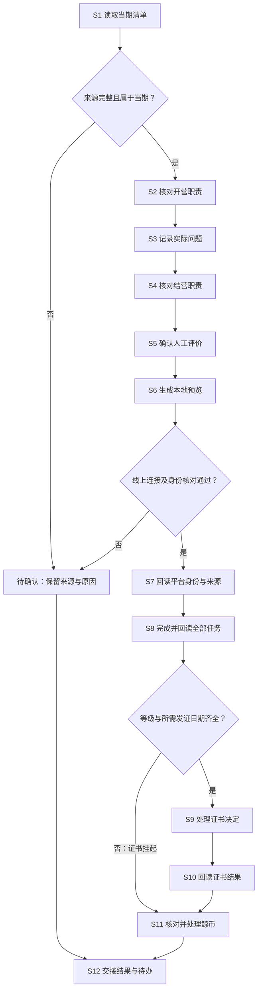

# 助教评价

脚本阶段、正式运行入口和历史兼容边界统一见[脚本维护与入口](../../Rules/脚本维护与入口.md)。保留实际平台适配程序，不在业务项目复制评价引擎。

清单增补、调组、人工等次/奖励更正、扩大范围、中断续跑及交付前，执行[全流程防漏与续跑](../../Rules/全流程防漏.md)。评价必须比较当前共享清单全员和本批计划，不能只读取旧人员ID。未知decisions键报错；正式适配器须提供readSourceInventory()全量合同。入口实际 `--apply` 需补 `--audit <核对输入JSON>`，已有已验收任务/证书复用。

从招募交来的当期助教清单开始，完成开营检查、问题记录、结营检查、人工评价、平台任务与优秀助教证书核对、鲸币核对，留下可回读的评价和发放交接材料。

先按下图找步骤，再查操作表。字段与业务口径只在 [Rules.md](Rules.md) 维护；[样例说明](Sample/字段说明.md) 只帮助理解文件结构，不能替代当期事实。

## 环境准备

| 项目 | 准备内容 |
| --- | --- |
| Skill 包根目录 | 含 README.md、skills/、runtime/ 的正式包目录；由项目指定位置，跨设备保留内部结构 |
| 助教项目根目录 | 保存本期共享表快照、人工确认与执行回执的项目目录，由项目交接提供 |
| 本地预览 | Node.js ≥20；无需平台写权限。配置中的相对文件路径按配置文件所在目录解析 |
| 共享表访问 | 从招募交接单取得工作簿链接、工作簿 token、子表 ID 与当期月份；打开后核对表头及人员，不用旧期 ID 代替 |
| 平台访问 | 当前已登录、具有对应项目权限的贡献者平台账号；线上执行还需本期 `evaluation.adapter_file` |
| 当前实现边界 | 本包没有可直接使用的平台连接程序。未提供连接程序时只做本地预览和人工平台核对；不能声称自动完成任务或发证 |
| 输出位置 | 当期项目 `output/<本期批次>/助教评价/` 下的新目录；正式发放回执和待办分别保存 |

### 当期材料：输入、过程文件与输出

| 类别 | 材料 | 从哪里取得／放在哪里 | 使用边界 |
| --- | --- | --- | --- |
| 输入 | 当期助教清单及完整快照 | 招募交接的共享表；保存为 `headers + rows` JSON | 真实评价以此为准；保留姓名、微信号、课程、职责、群号及人工字段 |
| 输入 | 开营与结营证据、真实问题记录 | 助教与课程负责人提供，附来源链接或记录 ID | 未核实不能填“已核实完成” |
| 输入 | 人工等级、资格与 S 档加成确认 | 负责人在清单确认；补充决策文件见 Rules | 不由消息量或完成项数自动推断 |
| 输入 | 学习者招募开始日期、平台项目与任务 ID | 当期招募材料及平台回读 | 日期缺失阻断需发证人员的证书步骤，不阻断任务核对 |
| 输入 | 本期配置与平台连接程序 | 执行人按 [字段表](Rules.md#s1-读取当期清单) 准备 | 线上程序须支持重新读取来源及平台状态 |
| 中间值 | 状态码、身份匹配结果、评价与发放预览 | 新预览目录 | `applied:false` 不代表线上已执行 |
| 输出 | 人工评价清单、执行台账、核验结果、待办 | 当期输出目录及共享表回读 | 分开报告任务、证书、鲸币结果 |
| 样例 | `Sample/配置.json` 等 | 本 Skill 的 Sample 目录 | 匿名结构示例；日期、人员、等级、金额、平台 ID 不作为当期默认值 |

## 处理流程图

S 编号与下方操作表、Rules 小节一致。开营后只记录实际问题，不另加逐 Task 巡检。



## 处理方式表

| 步骤 | 负责人 | 输入及来源 | 具体入口／命令与操作 | 输出位置 | 完成依据 | 异常去向 | 规则 |
| --- | --- | --- | --- | --- | --- | --- | --- |
| S1 读取清单 | 执行人 | 招募交接的当期共享表 | 打开工作簿及子表，完整读取为快照，核对月份、表头、行数 | 本期输入目录 | 无分页截断；课程、职责、姓名、微信号、评价列唯一 | 来源不明回招募补交 | [S1](Rules.md#s1-读取当期清单) |
| S2 核对开营职责 | 观察员／课程负责人 | 清单、培训及开营证据 | 按岗位逐项核对，记录状态码和证据 | 当期清单／确认文件 | 每个适用项有明确文字状态 | 无证据记待核对 | [S2](Rules.md#s2-核对开营职责) |
| S3 记录实际问题 | 课程负责人 | 实际发生的问题 | 记录问题、来源、影响和处理结果 | 当期问题记录 | 可追溯至具体事项；无问题不编造记录 | 未解决交负责人 | [S3](Rules.md#s3-记录实际问题) |
| S4 核对结营职责 | 观察员／课程负责人 | 答疑、评审、评优及结营交接 | 按岗位逐项核对结营状态 | 当期清单／确认文件 | 适用项有状态、证据及未解决事项 | 缺材料保留待核对 | [S4](Rules.md#s4-核对结营职责) |
| S5 确认人工评价 | 负责人 | 清单及 S2—S4 证据 | 人工填写 S/A/B/C/D，确认资格、S 加成；不得自动打分 | 共享表及决策文件 | 等级、资格、奖励依据分别明确 | 缺项保留待确认 | [S5](Rules.md#s5-确认人工评价) |
| S6 生成预览 | 执行人 | 本期配置、快照、决策文件 | 执行下方 `evaluation-preview` | 新预览目录 | 预览人数、身份、等级、金额与源表一致；查看全部待办 | 修正输入后换新目录重跑 | [S6](Rules.md#s6-生成本地预览) |
| S7 回读平台身份 | 执行人 | 平台当前记录及源表 | 有连接程序时运行不带 `--apply` 的 awards；否则人工核对 | 平台匹配记录 | 姓名、微信号、课程、职责及 assignment_id 唯一一致 | 错配或重复停止线上操作 | [S7](Rules.md#s7-回读平台身份与来源) |
| S8 完成全部任务 | 已获执行授权的执行人 | S7 当前核对结果 | 连接程序先完成整批任务并逐条、整批回读；无连接程序时人工执行并留证 | 执行台账／平台回读 | 全部任务完成后才进入证书处理 | 任一任务失败停止发证 | [S8](Rules.md#s8-完成并回读全部任务) |
| S9 处理证书决定 | 同上 | 已完成任务、人工等级、日期 | S/A/B 按规则发优秀助教证书；C/D 标记不发证 | 平台回执 | 证书决定与等级及截止日一致 | 缺等级／日期挂起；既有证书冲突停止 | [S9](Rules.md#s9-处理证书决定) |
| S10 回读证书结果 | 执行人 | 平台最新任务及证书记录 | 核对证书类型、等级、日期和任务身份 | 执行核验结果 | 实际回读一致；不以提交成功代替 | 冲突交人工，不自动撤证 | [S10](Rules.md#s10-回读证书结果) |
| S11 核对鲸币 | 负责人／执行人 | 人工资格、S 加成、平台既有金额 | 单独核算与回读；只处理已确认且未发放部分 | 奖励结果及待办 | 金额与规则一致，不重复发放 | 金额未知挂起；既有非零冲突停止 | [S11](Rules.md#s11-核对并处理鲸币) |
| S12 交接结果 | 负责人 | 清单、全部回读及未解决事项 | 汇总任务、证书、鲸币的独立状态 | 本期交接单 | 每项有结果、证据或待办负责人 | 未完成项明确交接，不报全部完成 | [S12](Rules.md#s12-交接结果与待办) |

## 常用命令与最简提示词

给 Agent 的参考提示词：

```text
使用 team-learning-assistant-evaluation，读取我提供的当期助教清单和评价依据。
先生成评价与发放预览，列出待确认项；不要执行线上发放。
```

在 **Skill 包根目录**执行。把尖括号换成实际路径，不要原样粘贴。配置文件可以用绝对路径；相对路径从当前目录找。配置内部的文件路径从配置文件所在目录找；`--out` 从当前目录找。每次使用新输出目录。

| 命令 | 用途与完成依据 |
| --- | --- |
| `node runtime/assistant/scripts/助教评价入口.mjs evaluation-preview --config "<本期配置.json>" --out "<新预览目录>"` | 仅本地。输出 `评价与发放预览.json`、`岗位适用项.html`、`运行摘要.json`；核对预览及待办 |
| `node runtime/assistant/scripts/助教评价入口.mjs evaluation-awards --config "<本期配置.json>" --out "<新平台核对目录>"` | 需要自备 `adapter_file`；读取线上状态但不发放。不是纯本地预览 |
| 上一命令改用新输出目录，并加 `--apply` | 仅在授权后执行；同一次执行依次处理 S7—S11，不为每一步重复发放。检查 `执行台账.jsonl`、`执行核验结果.json` 与实际平台状态 |

## 待确认与交接

| 缺口 | 阻断范围 | 补齐方式 |
| --- | --- | --- |
| 当期清单来源、身份或岗位不唯一 | 对应人员线上操作 | 回招募或负责人核对，不按昵称猜人 |
| 无人工等级 | 证书与金额判断 | 负责人补等级；任务可单独核实 |
| 缺学习者招募开始日期 | S/A/B 证书 | 从当期材料确认 YYYY-MM-DD；不是助教截止日 |
| 资格、S 加成未确认 | 鲸币金额 | 人工确认；不以历史值补齐 |
| 无平台连接程序或权限 | 自动线上执行 | 提供适配程序并核验，或人工执行留证；本地预览可继续 |

交接保留当期助教清单、证据、人工评价、平台身份与执行回执、奖励结果和待办。助教评价不替代学习者结营资格核验；后者交 [打卡与结营](../team-learning-checkin/SKILL.md)。平台优秀助教证书也不走学习者制证账本。
