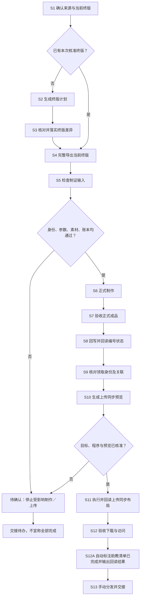

# 制证与领取

对学习者交付的领取入口必须是独立查询页（`/share/base/query/…`），不能用原 Base、领取表或普通视图链接代替。标题固定采用“xx期组队学习证书领取”（xx取当期JSON的期数）；页面备注逐字为“输入证书昵称，查询下载证书”。只保留“证书昵称”一个查询字段，结果只展示证书昵称及实际证书附件。必须实际查询含双证书人员并核对下载，保存真实发布链接；内部领取视图仅作管理用途。具体见 [Rules S11](Rules.md#领取页面固定布局)。

仅准备终版及领取身份行、或设置周期同步时，先读 [名单准备与周期同步](references/名单准备与周期同步.md)。该步骤可先建立待制作名单及关联；成品制作、附件交付和实际领取仍分别按下述流程验收。

## 不参加飞书打卡的课程

课程事实以当期已确认 `课程信息.json` 为准。必须遍历其中全部课程生成课程制证准备信息，不能只从飞书结营规则集合提取课程。课程编码跨期固定复用；先核对持久登记表和正式证书账本，别名映射到同一课程，不能另占新号；不同课程不能复用同一号。

`graduation_mode=manual_roster` 的课程跳过飞书打卡资格核验，仍生成课程名称、稳定键、课程编号、营期编号、营期名、制证日期和编号结构；人员和流水号留空，标明“等待人工补入核准名单”。未确认日期保留待确认。

负责人后续将真实人员补入现有证书制作表，记录稳定人员标识、课程、群号、证书昵称、证书类型、人工核准状态、核准人及依据。按“同营期＋同课程＋同稳定身份＋同证书类型”查重，保留人工优秀选择，随后与其他课程统一制证。没有飞书来源不构成拒绝条件，但人工名单未经核准、身份不清、日期或编号要素缺失时仍不制作正式证书。

这条人工链不得伪装成 `all_required_tasks` 自动通过，不伪造来源记录ID。现有 `final-plan` 只接收打卡结营结果；人工补名单走现有制证表及人工核准检查，不能塞入 graduate 的 learners 冒充自动通过。正式编号仍由统一账本分配，不能用表格行号或本期重新计数替代。

新增/更正名单、扩大范围、中断后继续及交付前，先执行[全流程防漏与续跑](../../Rules/全流程防漏.md)。从当前终版和用户明确增量独立枚举全部课程、人员与角色，不能只核对旧制证计划。缺配置列为待确认，已上传且验收一致的证书复用；实际制作补 `--workflow-audit`，上传补 `--audit`。旧生产配置必须先补本批核对输入，不能直接重放。

本skill从已核验的结营名单和当前人工评优终版开始，整理证书计划、导出并检查制证输入，使用正式账本生成个人证书，核对编号回写、附件与领取页面。课程群证书全部制作、上传并验收后，Agent 自动将当期助教清单中对应课程群、助教姓名行的证书状态标为“已完成”，输出回写结果和领取链接，交给助教手动分发。详细规则见 [S12A](Rules.md#s12a-自动标注助教清单并输出结果)。

制证只采用已确认的 PPTX 模板，经 PPT 脚本填充并由 PowerPoint 导出 PNG；PNG 是交付图片，不是制证底板或直绘引擎。不生成个人 ZIP。图片名直接拼接为 `证书昵称+证书类型.png`。实际运行配置若仍指向 PNG 底板或非 PPT 渲染器，停在 S5，不沿用旧配置正式制作；本轮暂不改运行配置与 SOP。

10 月 Base 的内部终版与领取表已完成字段、跨表关联和视图结构测试；它们尚无正式制证记录。终版证书类型由助教依据“结营与评优”人工结果确认，一证一行；领取表按已确认身份汇总同人同课同营期的实际附件，不能把空结构或临时测试行当作可领取证书。实际入口与测试边界见 [Rules S3](Rules.md#s3-核对并落实终版差异)。

本地计划、正式生成、线上上传、领取可用与实际分发是不同结果。先按下图定位，再查操作表；业务和字段口径以 [Rules.md](Rules.md) 为主要入口。

## 环境准备

| 项目         | 准备内容                                                                                          |
| ---------- | --------------------------------------------------------------------------------------------- |
| Skill 包根目录 | 包含 skills、runtime；跨设备替换根目录，保留 runtime 内相对结构                                                   |
| 学习者项目根目录   | 包含 workflow；本期 input／output／state 位于该项目 workflow 下                                            |
| 助教项目根目录 | 保存当期终版导出、领取状态和上传适配程序的项目目录，由项目交接提供 |
| 本地计划／导出    | Node.js ≥20；线上导出还需已授权 lark-cli                                                                |
| PPT 制作     | 唯一制证方式；需要 Python ≥3.10、Windows、PowerPoint、PowerShell、包内制作模板、确认的字体与正式账本。--check 不替代 PPT 实际导出验收 |
| 线上入口       | 当前终版与领取表所在 Base、稳定表／视图／字段 ID；读取完整分页后再操作                                                       |
| 领取程序       | `<助教项目根目录>/助教评价workflow/scripts/证书单次上传引用.mjs`，依赖同目录证书领取汇总.mjs，尚未内置本包。跨设备须另行提供这组程序与真实配置        |
| 当前限制       | 上传程序包含当前部署的字段 ID，不是更换 Base 即可通用的工具；新目标必须核对／适配后再执行。不运行旧的向领取表重复上传路线                             |

### 当期材料分类

| 类别 | 材料 | 来源／输出位置 | 边界 |
| --- | --- | --- | --- |
| 输入 | 已核验课程、结营及人工优秀名单 | [打卡与结营](../team-learning-checkin/SKILL.md) 交接 | 保留任务与身份依据、人工例外 |
| 输入 | 当前人工终版及记录 ID | 当期实际 Base 全量读取 | 一证一行；已核准终版优先，不被上游快照重建覆盖 |
| 输入 | 当期参数、素材、正式账本 | 负责人确认的配置与既有 state | 日期、角色／课程／营期编码、渲染方式必须明确；账本不能换成新建测试本 |
| 中间值 | final-plan、待确认、终版差异 | 本期输出目录 | 仅本地计划；不自动修改既有人工行 |
| 中间值 | 制证人员.json、制证配置.json、完整导出与验收 | 助教项目 output 下新目录 | 由当前终版导出；不是把示例复制后直接生产 |
| 输出 | manifest、PPT、按“证书昵称+证书类型”命名的 PNG、正式账本新增记录 | 本期新制证目录及既有账本 | 实际生产会修改本地正式账本，不是无副作用预览 |
| 输入／状态 | 终版行到稳定身份映射、领取状态、领取批次 | 本期配置及 state | 与打卡 registry 格式不同；批次列真实正式 manifest |
| 中间值 | 领取计划与上传预览 | 助教项目 output 下新目录 | 不代表已上传、已建表或已分发 |
| 输出 | 编号回读、附件回执、领取全量回读、下载核验、分发记录 | 本期交接目录及线上当前状态 | 各阶段独立验收 |
| 输入／输出 | 当期助教清单、证书状态回写结果 | 当期工作簿及对应工作表；本期交接目录 | 按课程、群号、助教姓名定位；回读“已完成”及下拉选项，保留人工“已发放” |
| 样例 | Sample 内 JSON | [样例说明](Sample/字段说明.md) | 结构示例，部分故意缺参数／真实文件；即便展示 complete、test_mode=false 也非生产证据 |

## 处理流程图



## 处理方式表

| 步骤 | 负责人 | 输入及来源 | 具体入口／命令与操作 | 输出位置 | 完成依据 | 异常去向 | 规则 |
| --- | --- | --- | --- | --- | --- | --- | --- |
| S1 确认来源 | 负责人／执行人 | 结营交接、当前终版、当期参数 | 核对核准范围、营期、来源 ID、人工例外和正式账本 | 本期输入目录 | 各项可追溯，不以历史名单补事实 | 回上游或负责人确认 | [S1](Rules.md#s1-确认来源与当前终版) |
| S2 生成计划 | 执行人 | course_info、graduates、existing_final、角色编码 | 执行 final-plan | 新终版计划.json | creates、pending 逐项可核对，updates 不覆盖人工行 | 冲突留 pending | [S2](Rules.md#s2-生成终版计划) |
| S3 落实终版差异 | 负责人／已获授权的执行人 | 计划与当前人工终版 | 审核后只落实确认差异并回读；已有核准终版可跳过 S2—S3 | 当前终版及回执 | 一证一行，人工昵称、例外、旧编号保留 | 不明差异交人工 | [S3](Rules.md#s3-核对并落实终版差异) |
| S4 导出终版 | 执行人 | 本期终版配置 | 在助教项目根目录运行最终证书名单.mjs | 项目内新制证输入目录 | 分页、版本、行数及最终来源验收通过 | 来源变化或截断重读 | [S4](Rules.md#s4-完整导出当前终版) |
| S5 检查输入 | 执行人 | 导出人员／配置、实际素材和正式账本 | 运行个人证书制作.py --check；另核对选定渲染器环境 | 检查结果／日志 | 参数、身份、素材与编号一致；PPT 环境另确认 | 缺一项不正式制作 | [S5](Rules.md#s5-检查制证输入) |
| S6 正式制作 | 已获制作授权的执行人 | S5 同一输入与既有正式账本 | 使用确认的 PPT 模板，指定新输出目录执行制作 | PPT、PNG、manifest、正式账本 | 制作程序成功，仅是待验收成品 | 失败保留账本和运行状态，先核对再续作 | [S6](Rules.md#s6-正式制作) |
| S7 验收成品 | 执行人／负责人 | 本批 manifest、文件和账本 | 核对数量、命名、身份、编号、哈希及视觉样张 | 本期验收记录 | complete、test_mode=false，文件与正式账本一致 | 不符不上传；不以重编号掩盖问题 | [S7](Rules.md#s7-验收正式成品) |
| S8 回写编号 | 已获授权的执行人 | S7 成品、当前终版记录 ID | 最小回写编号及实际制作状态，完整回读 | 终版与回执 | 当前终版每证编号与账本／manifest 一致 | 已有不同编号停止，人工处理 | [S8](Rules.md#s8-回写并回读编号状态) |
| S9 核对领取关联 | 执行人 | 当前终版、稳定身份、领取表 | 核对一人同课同营期一行及制证明细准确关联；缺行先准备并回读 | 当前领取表、身份状态 | 每个终版 record_id 都关联正确，不凭昵称合人 | 缺身份或目标表先确认，不能直接同步 | [S9](Rules.md#s9-核对领取身份及关联) |
| S10 生成预览 | 执行人 | 正式 manifest、真实配置与领取状态 | 运行单次上传引用程序，不加 --apply | 新上传预览目录 | 上传／复用数、目标表及关联明确，原字段受保护 | 目标 ID 不适配或旧附件不明则停止 | [S10](Rules.md#s10-生成上传同步预览) |
| S11 上传同步布局 | 已获授权的执行人 | 已审查预览及新鲜源表 | 换新目录，加 --apply 执行同一程序一次 | 线上附件、领取布局、回执及本地状态 | 源表原字段未变，token／数量／名称／布局完整回读 | 不盲目重试，不删除旧附件 | [S11](Rules.md#s11-执行并回读上传同步布局) |
| S12 验收领取 | 执行人／实际领取角色 | 当前领取视图与正式文件 | 实际下载抽样核对哈希，并按实际角色打开和下载 | 下载及访问验收 | 多证书同格齐全、哈希一致、角色可访问 | 未测权限只报当前账号验收 | [S12](Rules.md#s12-验收下载与访问) |
| S12A 标注助教清单 | Agent | 已验收课程群、当期助教清单及实际状态列 | 全量读取清单，按课程、群号及助教姓名匹配；将已完成课程群的对应助教行标为“已完成”，回读值与下拉选项 | 线上助教清单及本期《助教清单证书状态回写结果》 | 本群当前核准终版证书全部制作、上传、同步并验收；已有“已发放”保留 | 部分完成、缺记录、映射不明或写入失败列待办 | [S12A](Rules.md#s12a-自动标注助教清单并输出结果) |
| S13 分发交接 | 助教 | 已验收领取入口及待办 | 沿现有流程手动分发并记录实际结果 | 分发记录与交接单 | 以实际分发记录确认，不凭文件生成 | 未领取／未分发继续交接 | [S13](Rules.md#s13-手动分发并交接) |

## 常用命令与最简提示词

上传卡顿、中断或续跑时，按[传输耗时与断点续传](references/传输耗时与断点续传.md)使用包内上传入口。它记录逐证耗时，复用已有附件前实际下载核验；不自动升级包外适配程序，不代办领取同步。

```text
使用 team-learning-certificates，读取我提供的当期课程参数、已核准名单和当前终版。
先生成差异与制证检查结果，列出待确认项；不要正式制作、上传或改线上表。
```

尖括号换成实际路径。先切换到表中所列目录；命令行相对路径从该目录找。终版配置内路径按配置文件目录找；素材路径按生成的制证配置目录找。制作器参数和领取批次中的 manifest 路径建议用绝对路径，避免跨目录歧义。每次使用新输出目录／文件。

| 执行目录 | 命令 | 作用与完成依据 |
| --- | --- | --- |
| Skill 包根目录 | `node runtime/learner/scripts/learning-cycle.mjs final-plan "<终版计划输入.json>" "<新终版计划.json>"` | 仅本地；检查新增、冲突及待确认，不更新线上 |
| Skill 包根目录 | `node runtime/learner/scripts/learning-cycle.mjs receipt-plan "<领取计划输入.json>" "<新领取计划.json>"` | 可选本地校验；输入含实际 manifest、people、existing_receipts，逐张核对图片哈希；不创建领取表 |
| **助教项目根目录** | `node "<Skill 包根目录>/runtime/assistant/scripts/最终证书名单.mjs" "<本期终版配置.json>" "output/<新批次>-制证输入"` | 线上只读；输出必须在执行目录内，核对最终来源验收.json |
| Skill 包根目录 | `python runtime/assistant/scripts/个人证书制作.py --people "<输入目录>/制证人员.json" --config "<输入目录>/制证配置.json" --engine runtime/learner/scripts/certificates.py --check` | 本地检查；不生成正式证书，不替代 PPT 导出验收 |
| Skill 包根目录 | `python runtime/assistant/scripts/个人证书制作.py --people "<输入目录>/制证人员.json" --config "<输入目录>/制证配置.json" --engine runtime/learner/scripts/certificates.py --output "<新交付目录>" --ledger "<既有正式账本>" --workflow-audit "<本批全流程核对输入.json>"` | 正式制作；执行前重新检查本批完整范围；固定使用确认的 PPT 模板并实际修改账本 |
| **助教项目根目录** | `node "助教评价workflow/scripts/证书单次上传引用.mjs" "<本期终版配置.json>" "<领取批次.json>" "output/<新预览批次>"` | 包外线上只读预览；核对单次上传计划.json 与目标 ID |
| **助教项目根目录** | 上一命令换新目录并加 `--apply` | 同一次执行完成上传、token 同步和布局，并更新配置／状态文件；检查基础验收.json及实际全量回读 |

编号／状态回写、领取身份行准备不由制作器或单次上传程序自动代办；使用当前页面或经核对的 CLI 最小写入并回读，没有可在此照抄的通用命令。

正式制证任务继续执行 S12A：由 Agent 在本次流程内调用电子表格工具回写助教清单。无需等待人工再提示标注；这不是制作器内置回调或后台定时任务。

```text
使用 team-learning-certificates 完成本期已核准课程群的制作、上传及领取验收。
完成后自动将当期助教清单对应课程、群号和助教姓名行的证书状态标为“已完成”。
输出《助教清单证书状态回写结果》，列出课程、群号、助教姓名、单元格、原值、新值、回读结果及待办。
“已发放”由人工确认已转发到学习群后填写，已有“已发放”保留。
```

## 待确认与交接

| 缺口 | 阻断范围 | 补齐方式 |
| --- | --- | --- |
| 名单未核准、稳定身份不明、昵称异常 | 对应人员正式制证及领取 | 回助教核对，保留原值和人工例外 |
| 日期、课程／角色／营期编码、素材或渲染方式缺失 | 受影响批次正式制作 | 从当期材料确认，不取 Sample／性能测试参数 |
| 正式账本不明、已有编号冲突 | 正式制作及回写 | 核对既有账本，不新建替代本 |
| 包外程序、目标字段 ID、领取身份关联或状态缺失 | 自动上传同步 | 提供并核对实际程序／目标，不能仅改表名继续 |
| 未验证领取角色权限 | 对外可领取结论 | 用实际角色测试；不主动扩大分享 |
| 无实际分发记录 | “已分发”结论 | 助教按实际情况记录 |
| 当期助教清单入口、课程群映射或状态列不明 | 对应助教行状态回写 | 先完成可确认课程群的回写，输出无法定位的课程、群号及原因 |

交接当前终版定位、正式账本及 manifest、成品与验收、编号回读、附件回执、领取表／视图 ID、下载与权限证据、实际分发记录和待办。历史附件保留；删除或替换另按明确范围执行。
