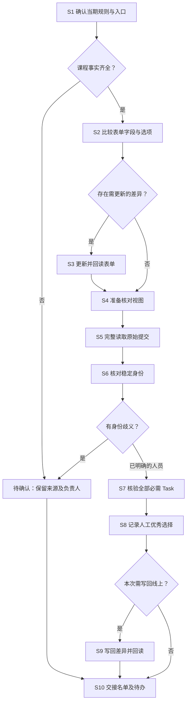

# 打卡与结营

## 功能介绍

从当期课程 JSON 准备打卡表单、课程 Task 日历和助教核对视图；读取完整打卡后核验身份与结营条件，记录人工评优，交出名单及待确认项。

只做开营准备或日历时，执行 S1—S4；核验结营时，再执行 S5—S10。业务条件及例外查 [Rules.md](Rules.md)，日历的输入与操作查 [课程日历操作](references/课程日历操作.md)。

## 环境准备

| 项目 | 准备内容 |
| --- | --- |
| Skill 包根目录 | 含 skills、runtime、Rules 的目录；采用项目 AGENTS.md 指定的正式包，跨设备保留内部结构 |
| 学习者项目根目录 | 包含 workflow 的目录；当期课程 JSON 路径由项目 AGENTS.md 指定 |
| 输入／输出／状态 | 项目 `workflow/input/<本期>/`、`workflow/output/<本期批次>/`、`workflow/state/`；保留原始快照和身份登记 |
| 本地运行 | Node.js ≥20；graduate、awards 只读写本地 JSON，不需飞书登录 |
| 线上访问 | 当期学习者打卡 Base、表单和视图链接；以实际 base_token、table_id、form/view ID 核对，不凭名称判断 |
| 线上操作入口 | 飞书页面或当前可用的 lark-cli；先读结构和差异，再按本次授权写入并回读。learning-cycle 不自动配置表单或写回 Base |
| 旧脚本边界 | 包内 new-period-base.mjs 仍依赖旧规划格式，不能直接拿标准课程 JSON 自动换期；需要线上换期时先单独核对适配方案 |

### 当期材料分类

| 类别 | 材料 | 来源／位置 | 用途与边界 |
| --- | --- | --- | --- |
| 输入 | 当期课程信息.json | [招募 S2](../team-learning-recruitment/SKILL.md) 的已校验输出 | 课程、群数、Task、营期及来源版本；变更先更新此文件 |
| 输入 | Base、表单、视图结构快照 | 当期平台完整读取 | 核对当前字段与选项，不照抄历史 ID |
| 输出 | 课程日历计划与回读 | 本期 output；线上独立课程日历表 | 展示 Task、开营和结营日期；待确认节点保留在明细表 |
| 输入 | 原始打卡记录 | 当期 Base 全量导出 | 保留 record_id、微信昵称、自动编号、提交时间及全部原始字段 |
| 输入 | 既有身份登记、人工确认、既有名单 | 项目 state、负责人确认及当前名单 | 维护同一人的稳定身份、昵称和人工优秀选择 |
| 中间值 | 表单差异、核验输入.json、身份异常 | 本期 input／output | 核验输入内嵌 course_info 对象及 records 数组，不是文件名 |
| 中间值 | graduate 结果及返回 registry | 本期 output | 先审查，再保存确认后的身份状态供下次使用 |
| 输入 | 人工优秀选择 | 助教在结营名单直接确认 | 评选人、依据、人员 ID 可追溯，不额外要求结营条件申报表单 |
| 输出 | 已核验／已评优结营名单、异常和写后回读 | 本期 output 及当前 Base | 一人同课同营期一条身份；保留人工决定 |
| 样例 | Sample 内 JSON | [样例说明](Sample/字段说明.md) | 匿名结构；不提供当期课程、Task 或真实平台 ID |

## 处理流程图



## 处理方式表

| 步骤 | 负责人 | 输入及来源 | 具体入口／命令与操作 | 输出位置 | 完成依据 | 异常去向 | 规则 |
| --- | --- | --- | --- | --- | --- | --- | --- |
| S1 确认规则 | 课程负责人／执行人 | 招募已校验课程信息、当期 Base 链接 | 核对营期、课程、群数、必需 Task 和稳定表 ID | 本期输入目录 | 每项有当期来源；未知值仍待确认 | 回课程规划负责人补齐 | [S1](Rules.md#s1-确认当期规则与入口) |
| S2 比较表单 | 执行人 | 当前表单结构与课程信息 | 完整读取字段、必填设置和选项，输出差异 | 本期输出目录 | 差异逐项列出，不改变历史提交 | 规则冲突回 S1 | [S2](Rules.md#s2-比较表单字段与选项) |
| S3 更新表单 | 已获授权的执行人 | 已确认差异 | 用当前页面或 CLI 最小修改后重新读取 | 线上表单及回执 | 课程、群号、Task、必填项与确认内容一致 | 权限不足或回读不符停止 | [S3](Rules.md#s3-更新并回读表单) |
| S4 准备视图 | 执行人／助教 | 当前表、课程 JSON 和核对需求 | 准备核对视图；需日历时按[操作说明](references/课程日历操作.md)生成并写入节点 | 当期 Base、本期 output | 日历日期、任务内容和配置回读一致 | 缺具体日期保留待确认 | [S4](Rules.md#s4-准备核对视图)、[日历规则](Rules.md#s4a-课程-task-日历) |
| S5 读取提交 | 执行人 | 当期打卡表 | 全量导出，核对分页、行数、营期与版本 | 本期 input 快照 | 未截断，无混入其他营期 | 重读，保留异常原记录 | [S5](Rules.md#s5-完整读取原始提交) |
| S6 核对身份 | 助教／执行人 | 原始微信昵称、课程、群号、既有 registry | 对照登记处理空昵称、别名与跨群；记录人工决定 | 身份登记及待确认 | 稳定人员标识唯一，确认来源可追溯 | 歧义人员不进入正式制证 | [S6](Rules.md#s6-核对稳定身份) |
| S7 核验 Task | 执行人／助教 | course_info、records、既有身份和名单 | 执行 graduate；逐项审查 missing_task_ids、pending 和昵称状态 | 新结营名单.json | 当期必需 Task 全部有效；人工名单课程列 skipped_courses | 缺任务不结营；身份／规则待确认交人工 | [S7](Rules.md#s7-核验全部必需-task) |
| S8 记录评优 | 助教／负责人 | 当前结营名单及人工选择 | 直接确认优秀字段，准备 selections 并执行 awards | 新评优名单.json | 只更新指定、唯一且已结营人员；保留评选依据 | 同名或资格冲突先确认 | [S8](Rules.md#s8-记录人工优秀选择) |
| S9 写回名单 | 已获授权的执行人 | 已审查名单与当前线上记录 | 比较差异后最小写入，保留人工核准与优秀值，再完整回读 | 线上名单及回执 | 身份、资格、优秀值与来源一致，未改无关字段 | 不覆盖人工差异，交负责人处理 | [S9](Rules.md#s9-写回差异并回读) |
| S10 交接 | 助教／执行人 | 名单、课程来源、身份状态、待办 | 将材料交给制证与领取；标明是否已写回 | 本期交接目录 | 每个待办有来源与负责人；正式制证条件明确 | 未核准部分保留不制作 | [S10](Rules.md#s10-交接名单及待办) |

## 常用命令与最简提示词

```text
使用 team-learning-checkin，按我提供的当期课程信息和完整打卡快照核验结营。
保留人工优秀选择，列出身份、Task 和昵称待确认项；先不要写回线上。
```

在 **Skill 包根目录**执行；输入和输出文件的相对路径都从该目录找。输入 JSON 内的 course_info、records、graduates 是实际对象／数组，不会按文件路径自动读取。每次使用新文件名，避免覆盖上次审查结果。

| 命令 | 输入与输出／完成依据 |
| --- | --- |
| `node runtime/learner/scripts/learning-cycle.mjs graduate "<核验输入.json>" "<新结营名单.json>"` | 输入格式见 Sample/打卡核验输入.json；输出 learners、pending、registry、summary。检查每人必需／缺失任务及身份异常，不只看总数 |
| `node runtime/learner/scripts/learning-cycle.mjs awards "<人工评优输入.json>" "<新评优名单.json>"` | 输入含 graduates 完整结果与 selections 数组；只应用人工选择。字段见 Rules S8 |
| `node runtime/learner/scripts/course-calendar.mjs "<当期课程信息.json>" "<新日历计划目录>" [--existing "<日历全量回读.ndjson>"]` | 本地生成节点、待确认项、字段及视图配置、每批最多200条的差异载荷；控制台只显示数量，操作见[日历说明](references/课程日历操作.md) |
| `node runtime/learner/local/run.mjs --config "<本地配置.json>" --preview` | 现有结营同步入口，读取真实全表并生成差异；核对后按本次授权改用 --apply。配置取项目输入，约束见[Rules S9](Rules.md#s9-写回差异并回读)；本机入口说明在项目 workflow/local/使用说明.md |
| 飞书页面或当前 CLI | 表单准备、日历写入及其他结构调整走当前平台能力；完成依据是实际结构及全部目标行回读 |

本地运行、跨Agent迁移或手动提醒，先读[本地运行与手动提醒](references/本地运行与手动提醒.md)。其中定义独立项目配置、预览／同步命令、人工字段保护、失败恢复和提醒的授权边界；不依赖本机路径或特定Agent。提醒只提示负责人手动运行，不等于获准自动同步。

## 待确认与交接

| 缺口 | 阻断范围 | 下一步 |
| --- | --- | --- |
| 课程、营期、Task 未确认或规划变更 | 对应课程资格判断 | 回招募更新课程信息，保留版本后重跑 |
| 空微信昵称、群号冲突、重复身份 | 对应人员资格与制证 | 人工确认；不以 created_by 或证书昵称猜人 |
| 必需项缺失、无有效任务或来源不完整 | 对应结营判断 | 补读或核对原记录，不伪造提交 |
| 证书昵称异常但资格已满足 | 正式制证，不必否定结营资格 | 人工确认有效昵称，保留原值 |
| 未确认优秀选择 | 对应优秀证书 | 助教确认；普通资格可独立交接 |

交给 [制证与领取](../team-learning-certificates/SKILL.md)：已校验课程信息及版本、完整来源快照、稳定身份登记、结营／评优名单、人工例外依据、线上回读（如已写回）、待确认清单。
