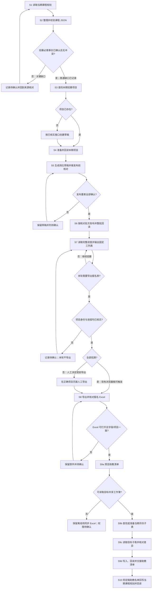

# 助教招募

新增课程/群数、报名更正或换人、扩大范围、中断续跑及导出交接前，执行[全流程防漏与续跑](../../Rules/全流程防漏.md)。当前课程×岗位与报名人员分别完整核对；不能以人数不变复用旧Excel。入口实际 `--apply` 需补 `--audit <核对输入JSON>`；缺全量报名内容时先核对/重新导出，导出点击不等于名单验收。

本 Skill 负责Datawhale每月组队学习助教招募，每月第一周周六固定运行。从输入@马燕鹏获取的**当期课程规划**链接开始，完成在[贡献者平台](https://contributor.datawhale.cn/task-square)创建招募项目、生成并核对岗位任务、读取招募进度、按决定导出报名表、准备当期[助教清单工作簿](https://yijuntech.feishu.cn/sheets/ZkQVscNm9hkf6gtQuLPcQErQnub)子表并交给助教评价，解决“本期助教招什么、招多少、何时导出、怎样核实并交接清单”的问题。

招募名单定稿并完成助教清单回读后，继续执行 **S10：将已核实助教名单回写到当期课程规划文档**。这一步是招募交付的一部分，不以共享表同步完成代替；流程和验收见 [Rules S10](Rules.md#s10-将招募完成的助教名单回写当期课程规划)。

先走下方路线，再按处理方式表逐行执行。业务规则和字段口径以 [Rules.md](Rules.md) 为唯一主要入口；[Sample](Sample/字段说明.md) 的配置快照仅供看格式，唯独[负责人微信二维码](Sample/负责人微信二维码.jpg)是用户确认的默认业务图片：本期未提供新二维码时使用它。

## 环境准备

### 目录与路径

在任意设备上先确定三个根目录，不依赖下列本机盘符：

| 名称 | 定义 | 配置示意 |
| --- | --- | --- |
| 学习者项目根目录 | 包含 `workflow/` 的学习者证书项目目录 | `<学习者项目根目录>` |
| 助教项目根目录 | 保存本期招募输入、输出和共享表回读的项目目录 | `<助教项目根目录>` |
| Skill 包根目录 | 含 README.md、skills/、runtime/ 的正式包目录 | 按项目指定位置定位；复制时保留完整的 team-learning-skills 发布包 |

本文命令均在 **Skill 包根目录**执行。直接调用脚本时，相对路径按当前工作目录解析；通过 `助教评价入口.mjs --config` 调用时，配置 JSON 内的相对路径按**配置文件所在目录**解析，`--out` 的相对路径仍按当前工作目录解析。跨设备时替换根目录，保持包内相对结构不变。

### 运行条件与访问入口

| 项目                    | 用途                   | 开始前检查                                                                       |
| --------------------- | -------------------- | --------------------------------------------------------------------------- |
| Node.js 20+           | 校验课程 JSON、生成预览和进度结果  | `node --version`                                                            |
| Python 3 + `openpyxl` | 读取报名 Excel、生成助教清单    | `python -c "import sys,openpyxl;print(sys.version)"`，也可在配置中填写 `python_path` |
| 已登录的贡献者平台             | 查找/创建项目、执行草稿、读取进度和下载 | 核对当前贡献者账号是否具有**管理者权限**，若缺少权限联系@吕豪杰；确认本期组队学习项目名称和真实项目 ID；                    |
| `lark-cli` 用户授权       | 读取工作簿、按需新建当期子表并同步助教清单 | 配置 `lark_cli_path` 或环境变量 `LARK_CLI_PATH`；登录有权限的飞书账号；先核对工作簿 token，已有子表须核对 `sheet_id`，新建前该 ID 留空 |

运行环境可用以下只读命令检查；它不创建项目、不发布、不写表：

```powershell
node runtime/assistant/scripts/助教评价入口.mjs health --config '<本期配置.json>'
```

## 处理流程

下表按**整个招募场景**标注类别：“中间值”指本流程生成、还要交给下一步处理的材料；一份文件可以是上一步的输出、下一步的输入。

| 类别        | 内容                                   | 取得位置                        | 保存位置                                         | 边界                                                                |
| --------- | ------------------------------------ | --------------------------- | -------------------------------------------- | ----------------------------------------------------------------- |
| 输入        | 当期课程规划原文                             | 当期航海群@马燕鹏指定的课程规划文档          | 学习者项目 `workflow/input/<本期批次>/`               | 记录文档 ID、实际版本和字段位置；缺失或冲突写“待确认”                                     |
| 中间值       | 待校验课程 JSON                           | 从当期规划逐字段整理                  | 学习者项目 `workflow/input/<本期批次>/课程信息-输入.json`   | 不从旧期或 Sample 补事实；交给课程校验脚本                                         |
| 中间值       | 已校验课程文件                              | 课程校验脚本输出的 `课程信息.json` 等四份文件 | 学习者项目 `workflow/output/<本期批次>-课程信息/`         | `课程信息.json` 继续供招募使用；其余文件分别供后续规则和待补核对使用                            |
| 输入        | 平台当前项目／任务、当前共享助教清单；仅在需继承配置时读取上期项目／任务 | 本期平台和共享表的完整读取；上期来源限已核实项目    | 助教项目 `input/<本期批次>/` 保存读取快照                  | 项目／任务 ID、来源版本和共享表目标须按本期回读；本期已明确给出提交成功页、证书场景和模板时，跳过上期读取            |
| 中间值       | 本期招募配置                               | 由课程文件、本期项目字段和已核对的可复用配置整理    | 助教项目 `input/<本期批次>/`                         | `recruitment.courses_file` 指向本期课程文件；`target_project_id` 使用真实回读 ID |
| 中间值       | 报名原始 Excel                           | “导出全部”实际下载                  | 助教项目 `input/<本期批次>/`                         | 是导出步骤的结果，也是填写清单的输入；保留原名、项目 ID 和导出时间                               |
| 中间值       | 岗位预览、进度表、名单写入计划                      | 各本地命令生成                     | 助教项目 `output/<本期批次>-招募/<步骤>-<北京时间>/`         | 用于核对下一步；本地预览不等于线上创建、发布或写表                                         |
| 中间值       | 当期月份子表 ID 和下拉回读                      | 共享工作簿只读查重、按需新建并回读           | 助教项目 `output/<本期批次>-招募/清单子表-<时间>/目标子表.json` | 已有子表按 ID 复用；新建子表名由 `period` 推得，如 `2026-10`→`10月`；写入前将回读 ID 填入本期配置 |
| 输出        | 已回读的助教清单交接材料                         | 当前共享表写后读取、原始 Excel、执行台账及截图  | 助教项目 `output/<本期批次>-招募/<步骤>-<北京时间>/`；共享表保留在线 | 核对写后差异、合并范围与 A:E 截图，再交助教评价 Skill                                  |
| 输入（默认业务图片） | `Sample/负责人微信二维码.jpg` | Skill 包内；本期未提供新二维码时选用 | 保留原文件；把已上传并核对的图片 URL 记入本期招募配置 | 本期提供新图则以新图优先；本地路径不能填作平台图片 URL；展示名不是已核实的文字微信号 |
| 样例（非当期输入） | `Sample/` 的匿名配置快照 | Skill 包内 | 仅用于理解结构和本地试跑 | 除上述二维码外，Sample 不提供当期课程、人员或平台参数默认值 |

### 处理流程图

图中 `S1`—`S8`、`S9a`—`S9d`、`S10` 与下方处理方式表、[Rules.md](Rules.md) 的同号章节逐一对应；判断框和 `C4` 只是步骤内分支，不是额外步骤。



## 处理方式

| 步骤           | 负责人         | 输入及来源                                 | 具体入口／命令与操作                                                                   | 输出位置                                         | 完成依据                                                                 | 异常去向                                     | Rules.md 对应规则                        |
| ------------ | ----------- | ------------------------------------- | ---------------------------------------------------------------------------- | -------------------------------------------- | -------------------------------------------------------------------- | ---------------------------------------- | ------------------------------------ |
| S1 读取规划      | Agent       | 当期规划原文、当前打卡课程名                        | 打开真实来源，记录文档 ID、修订号和每个字段的位置                                                   | 学习者项目 `workflow/input/<本期批次>/`               | 原文快照、来源标识和字段定位齐全                                                     | 来源不可访问、版本不明或材料冲突：写入待确认，不读旧期替代            | [S1 来源顺序](Rules.md#s1-读取当期课程规划) |
| S2 整理课程 JSON | Agent、课程负责人 | S1 原文；字段依据见规则表                        | 填写 `课程信息-输入.json`，运行 `course-info.mjs`                                       | 学习者项目 `workflow/output/<本期批次>-课程信息/`         | 命令成功生成四个文件；回读课程数、群数、Task、来源和 `待补清单.json`                             | 必填来源/身份错误：脚本拒绝；普通缺口：标“待确认”；群数未确认：停止招募    | [S2 字段与校验](Rules.md#s2-整理并校验课程-json) |
| S3 查找本期项目    | Agent       | 已校验 `课程信息.json`、本期项目名称/类型/期数          | 运行 `recruit-project` 生成浏览器稿；在已登录贡献者平台执行默认只读查重，完整分页按名称、类型、类别、期数核对 | 本轮输出目录 `项目准备结果.json`、`浏览器项目准备稿.js`；平台读取结果另存本期输入目录 | 唯一确认已有项目，或完整分页确认没有匹配项目；本地生成浏览器稿不算查重 | 同名多项、分页不完整、身份不明确：停止并待确认 | [S3 查找项目](Rules.md#s3-查找本期招募项目) |
| S4 准备项目      | Agent、负责人   | S3 查重结果；本期项目字段；确需继承时的上期可复用配置；本期新二维码或默认二维码 | 在同一已登录页面：已有草稿按 ID 回读；不存在时，经本轮确认调用 `window.assistantProjectRun(true)` 创建草稿并按 ID 回读；添加平台负责人暂为可选，证书配置单独核对；选定二维码图片并取得可回读的平台 URL | 助教项目 `input/<本期批次>/项目回读.json`，并把真实 ID、二维码 URL 写入本期覆盖配置 | 平台定向 `GET /projects/{id}` 回读名称、类型、类别、期数和 `draft`；若添加负责人，再回读其平台 ID；二维码/证书配置分别核对 | 请求结果不明先查列表，不重发；图片尚无平台 URL 时标待确认，不填本地路径 | [S4 准备项目](Rules.md#s4-准备并回读本期项目) |
| S5 生成并核对岗位草稿 | Agent       | S2 `课程信息.json`、S4 真实项目 ID、本期覆盖配置、岗位模板 | 运行 `recruit-preview`；检查预览与两轮审查；在登录页面先执行生成的浏览器稿预检，获授权后才创建草稿                   | 助教项目 `output/<本期批次>-招募/岗位草稿-<时间>/`           | 本地 `audit_round1/2.passed=true`；线上每课两个草稿任务均按 ID 回读，正文、表单、名额、截止、二维码一致 | 群数未知、正文超限、同名不同内容、项目非草稿、分页不完整：停止          | [S5 岗位草稿](Rules.md#s5-生成并核对岗位草稿) |
| S6 发布岗位      | Agent、负责人   | S5 全部草稿、当批人工核对记录、通过验收的平台适配器           | 先运行不带 `--apply` 的发布预检；核对后再用 `recruit-publish --apply`                        | 助教项目 `output/<本期批次>-招募/发布-<时间>/`             | `执行核验结果.json` 显示 `apply:true`、`readback:true`，项目和全部任务回读为已发布          | 缺适配器/核对文件、字段变化、截止过期或回读失败：停止；不盲目重试        | [S6 发布核对](Rules.md#s6-核对并发布岗位) |
| S7 读取进度      | Agent       | 完整项目任务 JSON、S2 课程 JSON、已有导出回执 | 运行 `recruit-progress`；若只监测而不打算导出，用只读快照运行本地命令，不执行会在满额时自动点击的浏览器稿 | 助教项目 `output/<本期批次>-招募/进度-<时间>/` | `未招满字段表.md` 固定为课程/岗位/进度三列；读取时间、项目 ID、分页完整性和异常结论齐全 | 缺项、重复、人数未知/超额、名额不符、未发布、未匹配任务：标待确认，不判满额 | [S7 固定进度](Rules.md#s7-读取完整进度并输出固定三列表) |
| S8 导出 Excel  | Agent、当期负责人 | S7 最新进度、当期导出决定、已有导出回执 | 满额且决定导出时，现有浏览器稿可触发；未满额但必须导出时，记录决定后在正确项目页面人工点击“导出全部”；两种情况都核对下载文件 | 助教项目 `input/<本期批次>/` 原始 `.xlsx`；导出决定和回执存本轮输出目录 | 文件实际存在、可打开，项目、岗位、状态和表单列与本期一致；记录导出时仍空缺的岗位 | 项目/进度异常先待确认；结果不明先查下载目录，不重复点击；未满额不得声称清单完整 | [S8 按决定导出](Rules.md#s8-按决定导出并核对报名-excel) |
| S9a 预览清单 | Agent | S8 核对后的原始 Excel、S2 课程 JSON | 运行 `roster-preview`，检查岗位槽位、缺人和待确认项 | 助教项目 `output/<本期批次>-招募/清单预览-<时间>/preview/` | `名单写入计划.json` 与 `助教清单_待同步.xlsx` 可打开；仅为离线预览 | Excel 不符或人员冲突：停止；无共享表权限时保留离线稿 | [S9a 预览清单](Rules.md#s9a-预览名单) |
| S9b 准备子表 | Agent、负责人 | 当期 `period`、已确认的工作簿 token；已有子表的真实 ID | 先运行 `roster-sheet-prepare` 只读预检；核对后运行 `--apply`，仅在不存在时新建 `N月` 子表；把回读 ID 填入配置 | 助教项目 `output/<本期批次>-招募/清单子表-<时间>/目标子表.json` | 同名唯一、表头 22 列和十项四状态单选回读通过；新建后取得稳定 ID | 权限不足、同名未核 ID、旧状态不在四项内：不建或不改，待确认 | [S9b 准备子表](Rules.md#s9b-准备当期共享子表) |
| S9c 核对差异 | Agent | S9a 名单预览、S9b 子表 ID、当前共享表 | 运行 `roster-read`，审核身份、旧人工数据及写入差异 | 助教项目 `output/<本期批次>-招募/清单读取-<时间>/` | 写前源表完整、`write_ready=true`，差异和合并计划明确 | 冲突、未分配、分页截断或源表变化：停止并待确认 | [S9c 读取差异](Rules.md#s9c-读取并核对差异) |
| S9d 同步交接 | Agent、负责人 | S9c 已核对的差异、当前目标表 | 经确认运行 `roster-sync --apply`，写后回读并完成 A:E 截图 | 助教项目 `output/<本期批次>-招募/清单同步-<时间>/` | `验收结果.json` 显示零剩余差异、合并范围完整；本轮着色格样式回读通过，截图及待确认项齐全 | 写前表变化或回读不符：查台账后处理，不整表覆盖 | [S9d 同步交接](Rules.md#s9d-写入回读与交接) |
| S10 回写课程规划 | Agent、负责人 | 当前已定稿并回读的助教清单、有效报名、人工核准决定、当期规划 | 按课程×群号×岗位核对助教姓名，读取最新文档块后最小更新并回读 | 助教项目 `output/<本期批次>-招募/规划名单回写-<时间>/` | 已核准人员逐项对账，文档修订号、回执和回读齐全；无差异记录复用 | 人员、映射、权限或版本冲突按对象列待办，不虚报已回写 | [S10 规划名单回写](Rules.md#s10-将招募完成的助教名单回写当期课程规划) |

## 常用命令

给 Agent 的最简启动提示词（替换尖括号即可）：

```text
请按 <Skill 包根目录>/skills/team-learning-recruitment/SKILL.md 处理本期助教招募。
当期课程规划：<链接或文件>。
助教清单共享表：<链接或文件>。
先校验课程信息、查重本期项目，再按文档推进；缺失或冲突标“待确认”。线上创建、发布、导出或写共享表前，先给我核对本批结果并确认。
```

先进入 **Skill 包根目录**，再运行以下命令。`<本期配置.json>` 可以填写完整路径；如果填写相对路径，就从 Skill 包根目录查找。配置文件中引用的其他文件，以配置文件所在目录为起点查找。`<新输出目录>` 请填写一个尚未创建的目录。

### S2 整理并校验课程 JSON（本地）

```powershell
node runtime/shared/course-info.mjs '<课程信息-输入.json>' '<新输出目录>'
```

- 参数：第一个是手工按当期规划整理的 JSON；第二个是新目录。
- 输出：`课程信息.json`、`助教课程事实.json`、`学习者证书规则.json`、`待补清单.json`。
- 完成依据：命令退出码为 0，四个文件均存在且回读字段对应原文。
- 当期规划变更时，在下一次岗位预览、发布或进度核对前，保留旧输入快照，按新原文和真实修订号更新 `课程信息-输入.json` 的对应字段及证据；用新输出目录重跑本命令，并把 `recruitment.courses_file` 改指向新 `课程信息.json`。若岗位已发布，本地 JSON 不会自动改动平台任务，先核对线上差异再单独处理。

### S3 查找本期项目（平台）

先把经本期来源确认的项目身份填入 `新建项目.json`，在配置文件的 `recruitment.project_file` 填该文件路径。`assistant_period` 是数字期数的字符串，不是年月；`Sample/新建项目.json` 仅供看格式，`sample_only:true` 禁止线上创建。运行：

```powershell
node runtime/assistant/scripts/助教评价入口.mjs recruit-project --config '<本期配置.json>' --out '<新预检目录>'
```

- 输出：`项目准备结果.json` 与 `浏览器项目准备稿.js`。没有平台适配器时，命令只生成浏览器稿，`platform_read:false`，不是线上查重。
- 在已登录贡献者平台运行浏览器稿，默认只读完整分页查重；保存结果及读取时间到本期输入目录。按 [S3 查找规则](Rules.md#s3-查找本期招募项目) 核对身份字段。

- 完成依据：唯一确认已有项目，或完整分页确认没有匹配项目；同名多项或分页不全时待确认。

### S4 准备并回读项目（平台）

S3 的浏览器稿提供 `window.assistantProjectRun(true)`：确认没有匹配项目且本轮获准创建时调用；它会再次完整查重，已有同身份草稿则复用，没有才 `POST` 一次并按 ID 回读。`true` 是实际线上写入，不是本地预览。若配置了已验收的 `recruitment.project_adapter_file`，也可在新的输出目录运行 `recruit-project --apply`；没有适配器时该命令明确拒绝执行。项目负责人添加与证书字段另行处理，不随项目创建请求发送。

```powershell
# 仅当配置中有本批已验收的 project_adapter_file 时，才用本地命令执行线上创建
node runtime/assistant/scripts/助教评价入口.mjs recruit-project --config '<本期配置.json>' --out '<新执行目录>' --apply --audit '<本批全流程核对输入.json>'
```

- 完成依据：真实 ID 可定向 `GET` 回读，项目身份字段匹配本期，状态为 `draft`。
- 未完成：只生成 `新建项目.json`、只看到成功响应但没有定向回读，均不算线上创建完成。

#### 需要继承时读取上期配置（浏览器）

本期已明确提供提交成功页、证书场景和模板时，在本期配置中将 `recruitment.previous_snapshot` 留空或设为 `null`，直接使用本期值。确需继承时，先核实 `previous_project_id`，再生成上期读取稿：

```powershell
node runtime/assistant/scripts/助教评价入口.mjs recruit-source --config '<本期配置.json>' --out '<新输出目录>'
```

- 输出：`<新输出目录>/上期来源读取.js`。在已登录贡献者平台的正确项目页面运行该稿，保存返回的项目及岗位 JSON 到助教项目 `input/<本期批次>/`，再把该文件路径填入 `recruitment.previous_snapshot`。
- 完成依据：上期项目 ID 与本期不同，所需字段来源已核对；只继承规则允许的配置。
- `Sample/上期招募配置快照.json` 是固定匿名试跑数据，不能代替这一步的真实来源核对。

### S5 岗位预览与草稿执行稿（本地 → 浏览器）

```powershell
node runtime/assistant/scripts/助教评价入口.mjs recruit-preview --config '<本期配置.json>' --out '<新输出目录>'
```

- 配置关键项：`recruitment.courses_file` 指向 S2 的 `课程信息.json`，`overrides_file` 指向本期覆盖配置，其中 `target_project_id` 必须是真实回读 ID。
- 输出：项目/任务配置、两轮审查、预览及 `浏览器草稿执行稿.js`。
- 本地完成依据：两轮审查通过，只说明载荷可核对。
- 线上草稿完成依据：在正确站点执行脚本预检后，经本轮授权调用 `window.assistantDraftRun(true)`；返回结果和最终整批回读均为草稿且字段一致。

### S6 实际发布（需本批适配器与核对文件）

```powershell
# 只读预检
node runtime/assistant/scripts/助教评价入口.mjs recruit-publish --config '<本期配置.json>' --out '<新预检目录>'

# 人工确认后实际发布
node runtime/assistant/scripts/助教评价入口.mjs recruit-publish --config '<本期配置.json>' --out '<新执行目录>' --apply --audit '<本批全流程核对输入.json>'
```

- 配置关键项：`publication.approval_file`、`publication.adapter_file`。
- 完成依据：实际执行目录中的台账与 `执行核验结果.json` 显示全部任务和项目已回读为发布状态；预检通过不等于发布。

### S7 读取完整进度（本地）

```powershell
node runtime/assistant/scripts/助教评价入口.mjs recruit-progress --config '<本期配置.json>' --out '<新输出目录>'
```

- 配置关键项：`courses_file`、完整的 `progress_snapshot`；如有旧回执，再给 `progress_receipt_file`。
- 输出：`招募进度.json`、`未招满字段表.md`、`浏览器进度与满额导出.js`。
- 当前实现边界：本地命令只生成结果和浏览器稿；执行该浏览器稿会在实时 `all_full=true` 时自动点击“导出全部”，未满额时只返回进度。若只监测而不打算导出，不执行该自动点击稿，只保存只读读取的项目任务快照并用本地命令生成进度。

### S8 按决定导出并核对 Excel（平台 → 本地）

- 满额且决定导出：使用 S7 生成的浏览器稿，执行前核对本期项目；现有稿实时回读为 `all_full=true` 时才会触发“导出全部”。
- 未满额但必须导出：当期负责人记录原因、项目 ID、读取时间、空缺岗位和本轮决定；Agent 核对项目身份、完整进度及异常后，由人在正确项目页面点击“导出全部”。再把原始 `.xlsx` 填入 `roster.export_file`，运行下方 S9 命令完成自动解析、清单预览和差异核对。当前脚本**不能**在未满额时自动代点；后续脚本统一更新时才增加带人工决定记录的受控触发模式。
- 下载完成依据：`.xlsx` 实际落盘、可打开且项目、岗位、审核状态和表单列与本期一致；只看到点击或下载提示不算完成。未满额导出只代表当时已提交人员的快照，不代表岗位招满或名单最终定稿。

### S9a—S9d 助教清单预览、准备子表与同步

```powershell
# 纯本地预览：使用配置中的导出 Excel 和可选快照
node runtime/assistant/scripts/助教评价入口.mjs roster-preview --config '<本期配置.json>' --out '<新预览目录>'

# 只读查找当期月份子表；如不存在，核对预检后才执行下一条
node runtime/assistant/scripts/助教评价入口.mjs roster-sheet-prepare --config '<本期配置.json>' --out '<新子表预检目录>'

# 新建或核对已有子表，并给十个检查项设置四状态单选
node runtime/assistant/scripts/助教评价入口.mjs roster-sheet-prepare --config '<本期配置.json>' --out '<新子表执行目录>' --apply --audit '<本批全流程核对输入.json>'

# 在线读取当前共享表并生成差异，不写入
node runtime/assistant/scripts/助教评价入口.mjs roster-read --config '<本期配置.json>' --out '<新读取目录>'

# 人工确认差异后才写入
node runtime/assistant/scripts/助教评价入口.mjs roster-sync --config '<本期配置.json>' --out '<新执行目录>' --apply --audit '<本批全流程核对输入.json>'
```

- 配置关键项：`roster.courses_file`、`export_file`；准备子表时给 `spreadsheet_token`，若当期月份子表已存在，须先确认并填写其 `sheet_id`；若确认不存在，`sheet_id` 留空。执行后将 `目标子表.json` 回读的 ID 填入本期配置，再运行 `roster-read`／`roster-sync`。
- 输出位置：预览计划和 `助教清单_待同步.xlsx` 在 `<out>/preview/`；在线写入的写前/写后快照和验收结果在 `<out>/`，写后复核计划在 `<out>/readback/`。
- 完成依据：预览只证明本地计划；`roster-sheet-prepare` 不带 `--apply` 只读查找，带 `--apply` 才可能建表或设置单选，需 `目标子表.json` 中 `readback=true`；`roster-read` 只证明当前表已读取；`roster-sync` 须有写后完整回读、零剩余差异、合并范围核对和 A:E 截图，才算共享表写入完成。单选状态为“待核对／已核实完成／存在问题／不适用”，适用项按岗位初始化；蓝色=运营适用、绿色=专业适用、灰色=不适用，颜色不代表完成。

### S10 将招募完成的助教名单回写当期课程规划

1. 输入为本轮平台有效报名及S9d写后回读的当期助教清单；已核准的人工补录、调组和兼任决定一并保留。只有已领取未提交、已释放、空姓名、身份不明或未经确认的手工名单，不作为招募完成名单。
2. 从当前课程JSON的来源标识定位当期规划，重新读取文档版本和各课程助教区域。按课程稳定键、群号、岗位核对对应姓名，不从旧期文档或旧导出补人。
3. 保存写前快照并列出逐项差异。运营助教对应“领航员”、专业助教对应“航海士”时，须核对当期文档实际岗位标签；其他称谓不能猜。只改助教姓名及已确认群号，不改课程内容、Task、日期、人工备注或其他角色。
4. 按已授权范围，用当前飞书文档工具定位块做最小更新。现有 `roster-sync` 只同步共享助教清单，不会自动更新规划；不得把其成功回执当作规划回写完成。
5. 写后重新读取涉及课程的全部助教区域，按“课程×群号×岗位×已核实人员”逐项对账；保存实际修订号、块定位、写入回执、完整回读和待确认清单。无差异则记录已核验复用，不重复写入。

输出放助教项目 `output/<本期批次>-招募/规划名单回写-<时间>/`。权限、身份或映射有疑点时保留可审查差异并列待办，不虚报“已回写”。撤回、换人或人工调组后从最新清单和规划重做这一步。详细规则见 [S10](Rules.md#s10-将招募完成的助教名单回写当期课程规划)。

## 待确认与交接

### 会阻断发布或清单填写的缺口

| 阻断点                                 | 处理                                             |
| ----------------------------------- | ---------------------------------------------- |
| 规划来源、课程身份、群数缺失或 Task 有冲突            | 回到当期来源核对；不得用历史值、Sample 或总次数补齐；agent提醒负责人完善课程规划 |
| 项目身份不唯一、项目 ID 未定向回读、项目不是草稿          | 停止创建岗位或发布，记录候选项目和差异                            |
| 截止、正文、四项必填表单、二维码的可访问 URL 与回读、名额或发布批次未核准 | 保留草稿；在核对记录中写“待确认”，不得发布。未提供新二维码时先选用 Sample 中的默认图片，不把其本地路径当作 URL |
| 进度分页不完整、任务缺失/重复、人数未知/超额、名额或状态异常     | 不判定全部招满，不触发导出                                  |
| Excel 缺少任务名称、审核状态或表单数据，或项目/岗位不符     | 保留原件并停止名单生成                                    |
| 共享表无权限、同名月份子表 ID 未确认、表头或已有状态不兼容 | 保留离线待同步 Excel；不新建重复子表、不覆盖人工值 |
| 名单存在身份冲突、未分配报名、未匹配的人工过程数据或线上表在预览后变化 | 不覆盖、不清空；重新读取后由负责人确认差异                          |

### 交给助教评价 Skill 的材料

S9d 完成并处理S10规划回写后，将以下材料交给 [team-learning-assistant-evaluation](../team-learning-assistant-evaluation/SKILL.md)。若S10因权限等原因待办，可交接已核实清单继续评价准备，但必须单列规划回写状态，不能宣称招募交付全部完成：

1. 已写后回读的当期助教清单及稳定的工作簿/子表 ID；
2. 本期课程、群号、岗位、姓名、微信号和保留的人工调组结果；
3. 招聘原始 Excel、名单写入计划、执行台账、完整回读与 A:E 截图；
4. 尚未解决的身份、空缺、超额、权限或人工字段冲突清单。
5. 当期课程规划的名单回写差异、文档修订号、块定位、回执与写后回读；无差异的复用记录或未完成事项也须保留。

交接完成不等于评价已执行。评价等次、任务完成、助教证书和鲸币办理继续由助教评价 Skill 处理。
